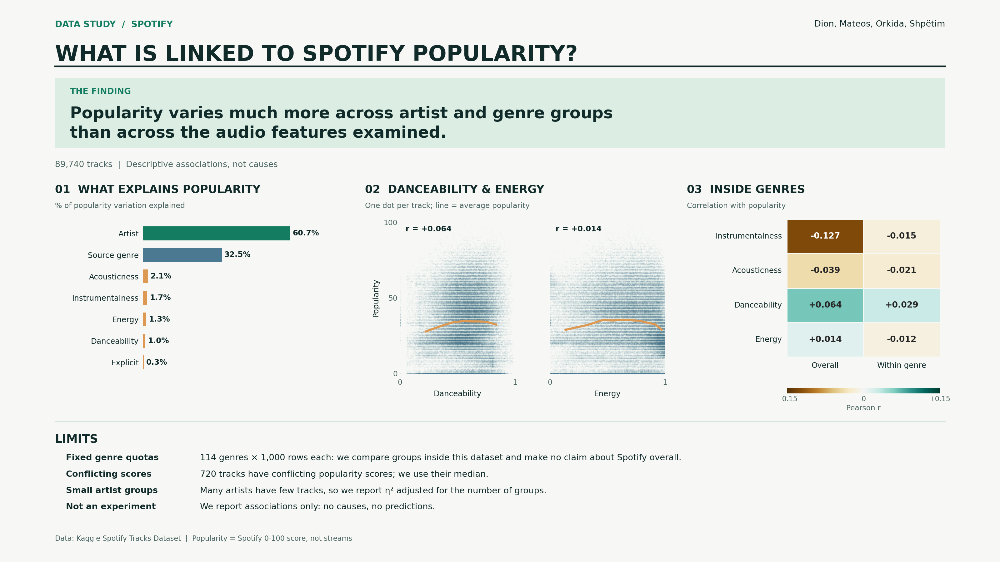

# Spotify Data Analysis

**Which track characteristics are associated with Spotify popularity?**

In this project, we explore how Spotify popularity varies across artist, genre and audio-feature groups. We use descriptive exploratory data analysis (EDA) with NumPy, Pandas, Matplotlib and Seaborn. We do not train a model, so our results are associations, not causes or predictions.

**Group members:** Dion, Mateos, Orkida, Shpëtim

## Dataset

We use the [Spotify Tracks Dataset (Kaggle)](https://www.kaggle.com/datasets/maharshipandya/-spotify-tracks-dataset), stored locally as `spotify.csv` (114,000 rows, 21 columns including the exported index).

- Each row is a **track–genre observation**, so the same `track_id` can appear several times.
- `popularity` is Spotify's 0–100 score, based largely on recent plays. It is **not** a stream count.
- Audio features (`danceability`, `energy`, `valence`, and so on) are scored from 0 to 1. `tempo` is in BPM, `loudness` in dB and `duration_ms` in milliseconds.

## Repository contents

| File | Description |
|---|---|
| `Spotify_EDA.ipynb` | Our full analysis: loading, cleaning, hypotheses, association measures, conclusions and poster generation |
| `spotify.csv` | Raw dataset |
| `Spotify_Popularity_Poster_From_Notebook.pdf` | Summary poster (vector) |
| `Spotify_Popularity_Poster_From_Notebook.png` | Summary poster (image) |

## Hypotheses

- **H1:** Tracks with higher danceability have higher average popularity.
- **H2:** Tracks with higher energy have higher average popularity.
- **H3:** Explicit tracks have higher average popularity than non-explicit tracks.

We compare the mean popularity of the top and bottom quartile (H1, H2) and of explicit and non-explicit tracks (H3). These are descriptive comparisons, not significance tests.

## Method

1. **Cleaning.** We drop the exported index and the one row with missing track identity. We merge the `songwriter` and `singer-songwriter` genres, which contain exactly the same track IDs.
2. **One row per track.** We keep one row per `track_id` (89,740 tracks, 17,648 main artists, 113 genres). Where repeats have conflicting popularity scores, we use the **median**, because the data has no dates to pick the latest score. We keep each track's first listed genre and use the first credited artist as the artist group.
3. **Association measures.** We use Pearson correlation between each audio feature and popularity. For grouped comparisons (artist, genre, explicit flag, deciles of each audio feature) we use the **adjusted η²**, the share of popularity variation that lies between groups, corrected for the number of groups.
4. **Genre control.** We compare overall correlations with within-genre correlations to see how much of an association comes from genre composition.

## Key findings

- **Artist and genre matter most.** The adjusted η² is about 61% for artist and 33% for source genre. No single audio feature exceeds about 2%.
- **Audio features are weakly related to popularity.** The strongest Pearson correlations are small: instrumentalness (−0.13), loudness (0.07) and danceability (0.06).
- **H1 (danceability): weakly supported.** The top quartile is about 3 points more popular than the bottom quartile.
- **H2 (energy): not supported.** The top and bottom quartiles have almost the same mean popularity.
- **H3 (explicit): supported as an unadjusted association.** Explicit tracks average about 4 points higher.
- **Genre composition explains part of the pooled association.** Within genres, the audio correlations shrink further, especially for instrumentalness.

## Limitations

- **Fixed genre quotas.** The dataset has the same number of rows for every genre, so it does not represent Spotify's catalogue or listening.
- **Repeated and conflicting scores.** We use the median score per track because no dates are available.
- **Small artist groups.** Many artists have only a few tracks, which is why we report the adjusted η².
- **Descriptive only.** We make no causal or predictive claims. The data has no release dates, streams or marketing information.

## Poster

Our poster summarises the findings with three graphs: a horizontal bar chart (what explains popularity), a scatter chart (H1 and H2) and an annotated heatmap (overall versus within-genre correlation). The notebook generates it as a PDF and PNG.



## Getting started

### Requirements

- Python 3.9 or later
- `numpy`, `pandas`, `matplotlib`, `seaborn`
- Jupyter (JupyterLab or Notebook)

```bash
pip install numpy pandas matplotlib seaborn jupyterlab
```

### Run the analysis

```bash
jupyter lab Spotify_EDA.ipynb
```

Run all cells from top to bottom. The notebook reads `spotify.csv` from the same folder and writes the poster files next to it.
